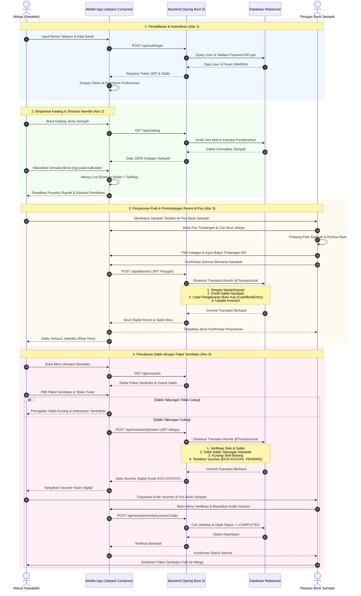
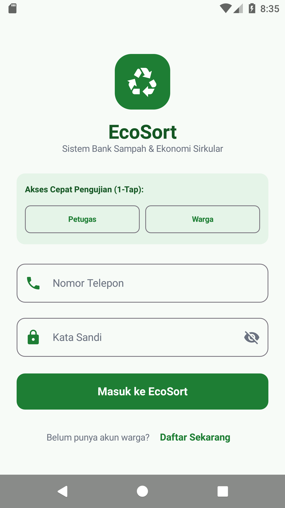
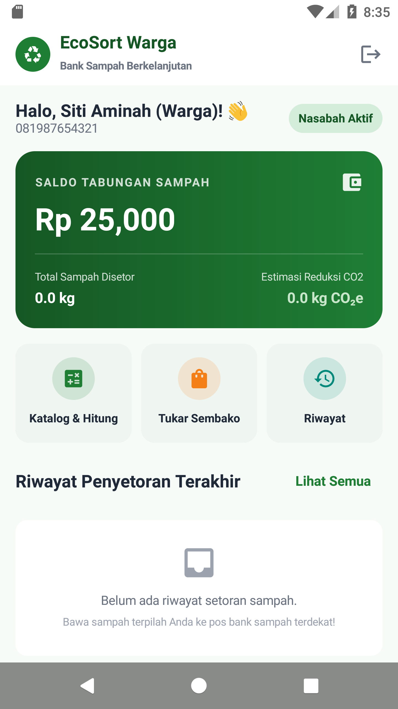
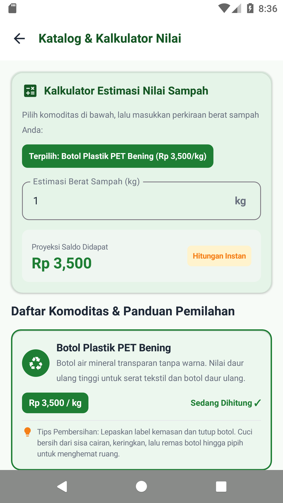
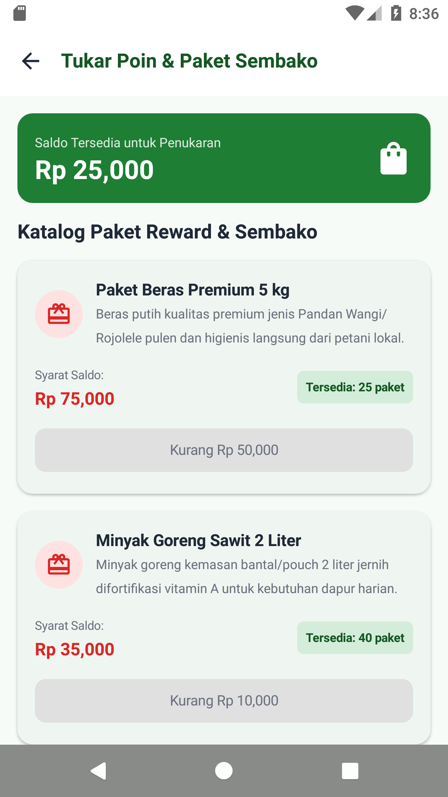
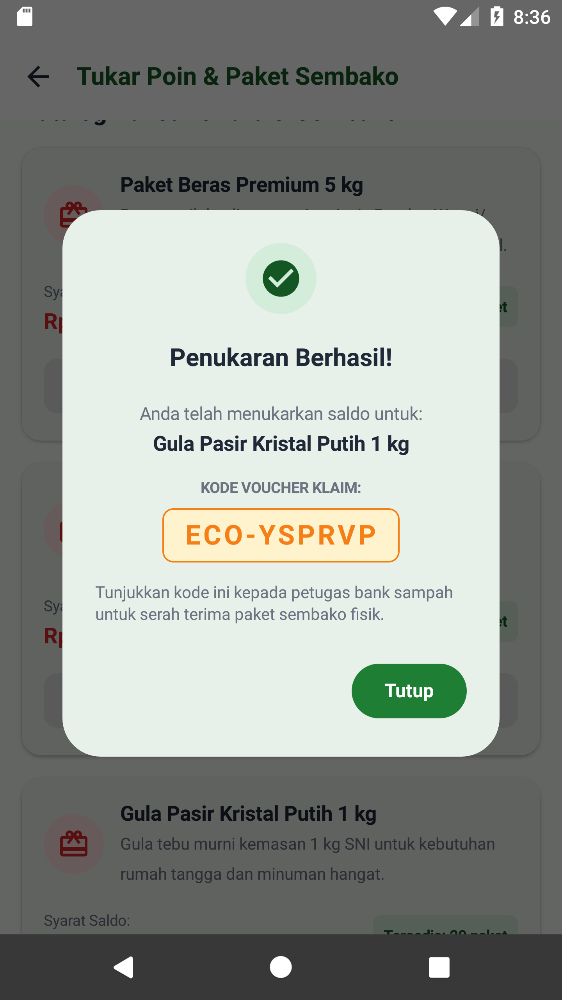
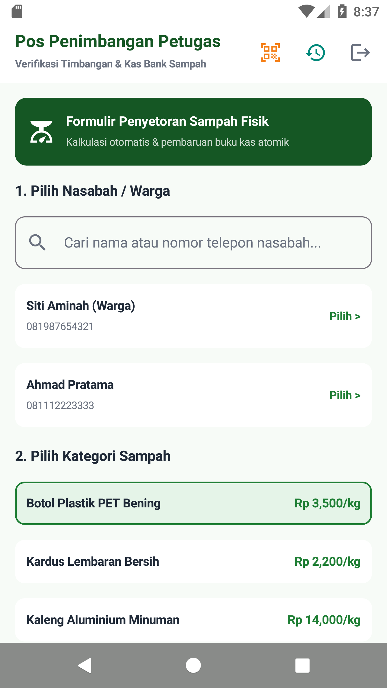
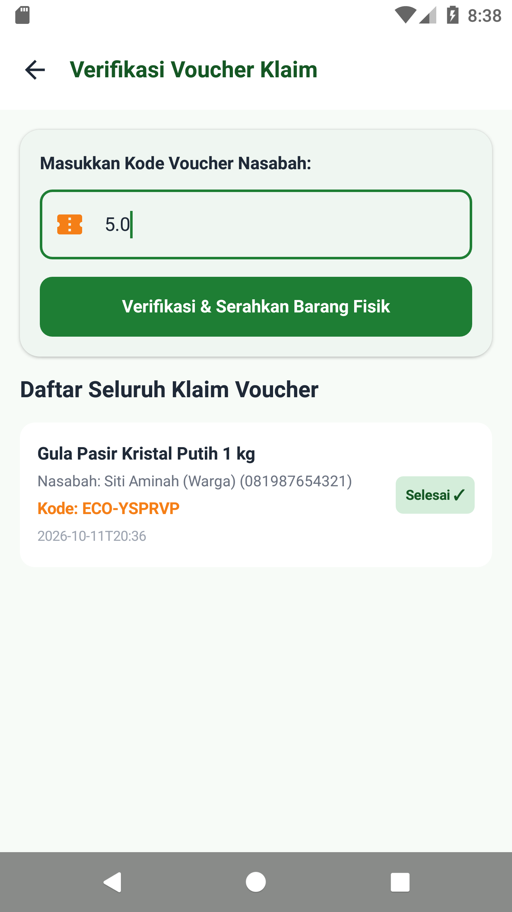
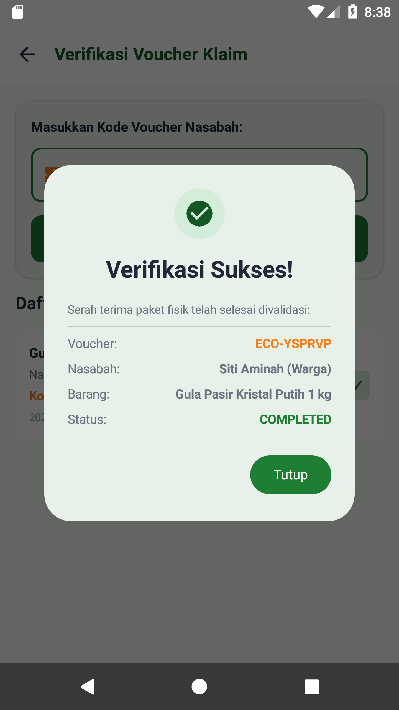

# EcoSort - Platform Digital Bank Sampah & Ekonomi Sirkular

EcoSort adalah platform teknologi terintegrasi yang dirancang untuk memodernisasi tata kelola operasional bank sampah komunitas dan mendorong partisipasi aktif masyarakat dalam gerakan ekonomi sirkular.

Sistem ini terbagi secara modular menjadi dua sub-proyek utama:
- `backend/`: RESTful Web Service berarsitektur **3-Tier Layered** berbasis **Spring Boot 3**, **Spring Security**, **JJWT**, **Spring Data JPA**, dan basis data relasional **H2 / PostgreSQL**.
- `frontend/`: Aplikasi mobile Android modern berbasis **Kotlin**, **Jetpack Compose (Material 3)**, arsitektur **MVVM (Model-View-ViewModel)** dengan pola **Unidirectional Data Flow (UDF)**, **StateFlow & Coroutines**, **Retrofit 2**, dan **DataStore Preferences**.

---

## Struktur Direktori Proyek

```text
E:\ciputra\visual\afl3\
├── .env.example                    # Template konfigurasi variabel lingkungan sistem
├── README.md                       # Dokumentasi arsitektur dan panduan eksekusi sistem
├── EcoSort_Postman_Collection.json # Koleksi Postman lengkap siap pakai
├── screenshots/                    # Dokumentasi tangkapan layar pengujian aplikasi di Android
│
├── backend/                        # Peladen REST API Spring Boot 3-Tier Layered
│   ├── .env.example                # Template konfigurasi port, DB, dan JWT secret backend
│   ├── build.gradle.kts            # Konfigurasi dependensi Gradle Spring Boot, JPA, JWT, Swagger, Dotenv
│   ├── settings.gradle.kts         # Root project settings backend
│   ├── gradlew / gradlew.bat       # Wrapper Gradle portable
│   └── src/
│       ├── main/
│       │   ├── java/com/ecosort/backend/
│       │   │   ├── EcoSortApplication.java     # Entry point Spring Boot
│       │   │   ├── config/                     # Konfigurasi Keamanan JWT, CORS, Swagger, & DataSeeder
│       │   │   │   ├── SecurityConfig.java
│       │   │   │   ├── JwtTokenProvider.java
│       │   │   │   ├── JwtAuthenticationFilter.java
│       │   │   │   ├── OpenApiConfig.java          # Swagger OpenAPI 3.0 & Bearer Scheme
│       │   │   │   └── DataSeeder.java             # Otomasi pengisian data awal
│       │   │   ├── controller/                 # Presentation Layer (REST Endpoints)
│       │   │   │   ├── AuthController.java         # /api/auth
│       │   │   │   ├── CatalogController.java      # /api/catalog
│       │   │   │   ├── DepositController.java      # /api/deposits
│       │   │   │   ├── RewardController.java       # /api/rewards
│       │   │   │   ├── CashBookController.java     # /api/cashbook
│       │   │   │   └── UserController.java         # /api/users
│       │   │   ├── dto/                        # Data Transfer Objects
│       │   │   ├── entity/                     # Domain Model Entity (JPA)
│       │   │   │   ├── User.java
│       │   │   │   ├── Role.java (WARGA, PETUGAS)
│       │   │   │   ├── WasteCategory.java
│       │   │   │   ├── WasteDeposit.java
│       │   │   │   ├── RewardItem.java
│       │   │   │   ├── RewardClaim.java
│       │   │   │   └── CashBookEntry.java
│       │   │   ├── repository/                 # Data Access Layer (Spring Data JPA)
│       │   │   ├── service/                    # Business Logic Layer (Transaksi Atomik)
│       │   │   └── exception/                  # Global Exception Handler
│       │   └── resources/
│       │       └── application.properties      # Konfigurasi port 8080, H2 DB, & JWT
│       └── test/                               # Pengujian Otomatis (Happy Path & Edge Cases)
│           └── java/com/ecosort/backend/
│               ├── DepositServiceTest.java     # Uji coba setoran fisik & validasi bobot
│               └── RewardServiceTest.java      # Uji coba penukaran saldo & cek saldo kurang
│
└── frontend/                       # Aplikasi Android Mobile Jetpack Compose MVVM
    ├── build.gradle.kts            # Konfigurasi plugin Android & Kotlin
    ├── settings.gradle.kts         # Modul include ":app"
    ├── local.properties            # Path Android SDK lokal
    ├── gradlew / gradlew.bat       # Wrapper Gradle Android
    └── app/
        ├── build.gradle.kts        # Compose BOM, Material 3, Retrofit, DataStore
        └── src/main/
            ├── AndroidManifest.xml # Izin internet & konfigurasi activity
            └── java/com/ecosort/app/
                ├── MainActivity.kt # Activity utama Compose
                ├── model/          # Data class domain & respons jaringan
                ├── network/        # Retrofit Client & Interceptor JWT
                ├── data/           # Jetpack DataStore Preferences
                ├── repository/     # Single Source of Truth Repositories
                ├── viewmodel/      # ViewModel (UDF & StateFlow)
                └── ui/
                    ├── navigation/ # Jetpack Compose Navigation Graph
                    ├── theme/      # Material 3 Color, Theme, & Typography
                    └── screens/    # Antarmuka Pengguna Reaktif
                        ├── LoginScreen.kt              # Masuk akun (Tombol 1-Tap Demo)
                        ├── RegisterScreen.kt           # Pendaftaran akun Warga / Petugas
                        ├── CitizenHomeScreen.kt        # Beranda Warga & Saldo Tabungan
                        ├── CatalogCalculatorScreen.kt  # Katalog & Kalkulator Nilai Real-Time
                        ├── RewardScreen.kt             # Penukaran Paket Sembako & Voucher
                        ├── OfficerDepositScreen.kt     # Pos Penimbangan Petugas & Setoran
                        ├── OfficerVerifyClaimScreen.kt # Verifikasi Kode Voucher Klaim Petugas
                        └── HistoryScreen.kt            # Riwayat Transaksi & Buku Kas Digital
```

---

## Kredensial Pengujian Bawaan (Default Data Seeder)

Saat peladen pertama kali dijalankan, `DataSeeder.java` akan otomatis mengisi data siap uji:

| Peran (Role) | Nomor Telepon | Kata Sandi | Saldo Awal | Keterangan |
| :--- | :--- | :--- | :--- | :--- |
| **PETUGAS** | `081234567890` | `password123` | Rp0 | Memiliki hak akses pos timbangan & verifikasi voucher |
| **WARGA** | `081987654321` | `password123` | Rp25.000 | Nasabah Siti Aminah |
| **WARGA** | `081112223333` | `password123` | Rp85.000 | Nasabah Ahmad Pratama |

> **Catatan Pengujian**: Pada layar login aplikasi Android telah disediakan tombol **1-Tap Quick Fill** untuk langsung mengisi kredensial Petugas atau Warga tanpa perlu mengetik manual.

---

## Panduan Menjalankan Sistem

### 1. Menjalankan Backend (Spring Boot)

Backend EcoSort telah mendukung manajemen variabel lingkungan menggunakan pustaka **Dotenv (`dotenv-java`)**. 

#### Konfigurasi File `.env`:
Tersedia template konfigurasi pada `.env.example`. Anda dapat menyalinnya menjadi `.env` pada direktori root atau `backend/`:

```powershell
# Menggunakan template bawaan
Copy-Item .env.example .env
```

Berkas `.env` memuat variabel yang dapat dikonfigurasi secara fleksibel:
```properties
# Port peladen Spring Boot
SERVER_PORT=8080
APP_NAME=ecosort-backend

# Konfigurasi Basis Data (Default H2 File DB atau PostgreSQL)
DB_URL=jdbc:h2:file:./data/ecosortdb;DB_CLOSE_DELAY=-1;DB_CLOSE_ON_EXIT=FALSE;AUTO_SERVER=TRUE
DB_DRIVER=org.h2.Driver
DB_USERNAME=sa
DB_PASSWORD=

# Kunci Rahasia JWT & Masa Berlaku Token
JWT_SECRET=9a3f9e6b2c8a1f5d7e3c4b9a0f2e8d1c6b4a7f9e2d5c8a1f4b7e0d3c6a9f2b5e
JWT_EXPIRATION_MS=86400000
```

> **Catatan Fleksibilitas**: Jika berkas `.env` tidak disediakan, peladen secara cerdas menggunakan nilai bawaan (*fallback default*) yang telah didefinisikan pada `application.properties`, sehingga sistem tetap dapat berjalan langsung tanpa hambatan.

#### Perintah Eksekusi Backend:
Buka terminal PowerShell pada direktori `backend/`:

```powershell
cd E:\ciputra\visual\afl3\backend

# Menjalankan pengujian otomatis (Unit & Integration Tests)
.\gradlew.bat test

# Menjalankan peladen Spring Boot (Port 8080)
.\gradlew.bat bootRun
```

- **Alamat Base URL**: `http://localhost:8080` (atau `http://10.0.2.2:8080` pada emulator Android)
- **H2 Database Console**: Buka peramban ke `http://localhost:8080/h2-console`
  - JDBC URL: `jdbc:h2:file:./data/ecosortdb`
  - User Name: `sa`
  - Password: *(kosongkan)*

---

### 2. Menjalankan Frontend (Android Jetpack Compose)

1. Buka folder `E:\ciputra\visual\afl3\frontend` menggunakan **Android Studio**.
2. Biarkan Gradle melakukan sinkronisasi dependensi.
3. Hubungkan perangkat fisik Android melalui USB Debugging atau gunakan **Android Emulator**.
4. Tekan tombol **Run (Shift + F10)** pada Android Studio untuk meng-install dan menjalankan aplikasi.

> **Catatan Konfigurasi Jaringan**:
> Secara default, `RetrofitClient.kt` menggunakan alamat `http://10.0.2.2:8080/` yang merupakan rute standar emulator Android ke localhost komputer Anda. Jika menggunakan HP fisik Android, ubah `BASE_URL` ke IP lokal WiFi laptop Anda (misal `http://192.168.1.X:8080/`).

---

## Alur Kerja Sistem (System Flows & User Journey)

EcoSort menerapkan pemisahan peran (*Role-Based Access Control*) yang jelas antara **Warga (Nasabah)** dan **Petugas Bank Sampah**. Berikut adalah visualisasi dan rincian alur kerja utama aplikasi:

### 1. Diagram Alur Operasional End-to-End (Bagan Alir Sistem)

Berikut adalah bagan alir proses bisnis menyeluruh yang mencakup siklus ekonomi sirkular dari pemilahan sampah di rumah hingga serah terima fisik sembako di bank sampah:

```mermaid
graph TD
    %% TAHAP 1: REGISTRASI & AUTENTIKASI
    subgraph Tahap1["1. Pendaftaran & Autentikasi Pengguna (Alur 1)"]
        A[Pengguna Buka Aplikasi EcoSort] --> B{Sudah Memiliki Akun?}
        B -->|Belum| C[Form Pendaftaran: Nama, No. HP, Alamat, PIN]
        C --> D[Backend: Hash BCrypt, Inisialisasi Saldo Rp0]
        D --> E[Login: Masukkan No. HP & Kata Sandi]
        B -->|Sudah| E
        E --> F[Backend Validasi Kredensial & Terbitkan Token JWT]
        F --> G{Pemeriksaan Otorisasi Peran / Role}
        G -->|Role: WARGA| H[Masuk Dasbor Nasabah Warga]
        G -->|Role: PETUGAS| I[Masuk Dasbor Pos Petugas]
    end

    %% TAHAP 2: SIMULASI SAMPAH
    subgraph Tahap2["2. Eksplorasi Katalog & Kalkulator Simulasi (Alur 2)"]
        H --> J[Buka Katalog Komoditas Sampah]
        J --> K[Pelajari Panduan Pemilahan & Tarif per kg]
        K --> L[Kalkulator Estimasi Nilai Sampah Mandiri]
        L --> M[Input Perkiraan Bobot Timbangan di Rumah]
        M --> N[Kalkulasi Real-Time Sisi Klien 0ms Latency]
        N --> O[Warga Membawa Sampah Terpilah ke Pos Bank Sampah]
    end

    %% TAHAP 3: SETORAN FISIK & TIMBANGAN
    subgraph Tahap3["3. Penyetoran Sampah Fisik & Verifikasi Timbangan (Alur 3)"]
        O --> P[Petugas Membuka Menu Formulir Setoran Fisik]
        I --> P
        P --> Q[Petugas Cari Nasabah via No. Telepon]
        Q --> R[Pemeriksaan Mutu Fisik & Penimbangan Riil]
        R --> S[Petugas Masukkan Angka Timbangan Riil di Pos]
        S --> T[Sistem Hitung Nilai Resmi: Bobot × Tarif Database]
        T --> U[Pemeriksaan Bersama & Konfirmasi Transaksi]
        U --> V[Eksekusi Transaksi Atomik @Transactional di Peladen]
        V --> V1[1. Simpan Catatan Riwayat Setoran WasteDeposit]
        V --> V2[2. Kredit Saldo Rekening Nasabah Real-Time]
        V --> V3[3. Catat Pengeluaran Kas Bank Sampah CashBookEntry]
        V --> V4[4. Tambah Akumulasi Inventori Sampah Terkumpul]
        V1 & V2 & V3 & V4 --> W[Struk Digital Resmi Terbit & Saldo Terbarui]
    end

    %% TAHAP 4: REWARD & SERAH TERIMA FISIK
    subgraph Tahap4["4. Penukaran Saldo Tabungan dengan Paket Sembako (Alur 4)"]
        W -.->|Saldo Warga Terakumulasi| X[Warga Buka Menu Reward Sembako]
        H --> X
        X --> Y{Validasi Kecukupan Saldo Tabungan}
        Y -->|Saldo Tidak Cukup| Z[Tombol Nonaktif: Tampilkan Sisa Nominal yang Kurang]
        Y -->|Saldo Cukup| AA[Warga Konfirmasi Klaim Paket Sembako]
        AA --> AB[Backend Eksekusi Transaksi Atomik @Transactional]
        AB --> AB1[1. Verifikasi Stok & Debit Saldo Tabungan]
        AB --> AB2[2. Kurangi Stok Item Barang Sembako]
        AB --> AB3[3. Terbitkan Kode Voucher Digital Unik ECO-XXXXXX]
        AB1 & AB2 & AB3 --> AC[Voucher Muncul di Riwayat Nasabah Status: PENDING]
        AC --> AD[Warga Tunjukkan Kode Voucher ke Petugas di Pos]
        AD --> AE[Petugas Masukkan Kode pada Menu Verifikasi Voucher]
        AE --> AF{Pemeriksaan Validitas Kode Voucher}
        AF -->|Status PENDING| AG[Verifikasi Sukses -> Status Berubah COMPLETED]
        AF -->|Sudah Dipakai / Salah| AH[Ditolak: Voucher Tidak Valid atau Telah Diklaim]
        AG --> AI[Petugas Menyerahkan Paket Sembako Fisik ke Warga]
    end
```



---

### 2. Diagram Sekuensial Interaksi Sistem (Sequence Diagram)

Diagram berikut memetakan pertukaran pesan secara mendalam antara **Warga**, **Aplikasi Android**, **Peladen Spring Boot**, **Basis Data**, dan **Petugas**:



---

### 3. Rincian Alur Berdasarkan Peran (Step-by-Step Flow)

#### A. Alur Kerja Warga / Nasabah (Citizen Flow)
1. **Registrasi & Masuk**:
   - Warga mendaftarkan diri dengan nomor telepon dan PIN/kata sandi, atau masuk menggunakan akun seeder `081987654321`.
   - Token JWT disimpan aman di Android Jetpack DataStore Preferences.
2. **Monitoring Saldo & Buku Tabungan**:
   - Menampilkan total saldo aktif, total berat sampah yang telah disetor, dan ringkasan transaksi terbaru.
3. **Simulasi Nilai Sampah (Kalkulator Sisi Klien)**:
   - Warga memilih jenis sampah (misal: *Botol Plastik PET Bening*, *Kardus Lembaran*, *Kaleng Aluminium*).
   - Memasukkan estimasi berat timbangan di rumah.
   - Sistem secara instan (*0ms latency*) mengalkulasikan proyeksi saldo yang akan diterima beserta petunjuk pembersihan material.
4. **Penukaran Saldo dengan Paket Sembako (Klaim Reward)**:
   - Warga melihat katalog barang reward (Gula Pasir, Beras, Minyak Goreng, dll.).
   - Jika saldo mencukupi, warga mengonfirmasi penukaran.
   - Transaksi diproses secara atomik di backend: saldo didebit seketika, entri klaim tercatat di database, dan kode voucher unik terbit (contoh: `ECO-YSPRVP`).

---

#### B. Alur Kerja Petugas Bank Sampah (Officer Flow)
1. **Penerimaan & Penimbangan Sampah Fisik**:
   - Petugas masuk menggunakan akun petugas (`081234567890`).
   - Petugas mencari dan memilih nasabah yang datang menyetor sampah.
   - Memilih kategori sampah yang disortir.
   - Memasukkan angka berat riil dari timbangan fisik (misal: `5.08 kg`).
   - Sistem backend menghitung nilai resmi dan mengeksekusi transaksi `@Transactional`:
     - Menambah catatan setoran fisik sampah (`WasteDeposit`).
     - Mengkredit saldo tabungan nasabah.
     - Mencatat mutasi keluar pada buku kas operasional bank sampah (`CashBookEntry`).
   - Muncul struk digital resmi bukti setoran yang menampilkan detail material, bobot, tarif, dan saldo akhir nasabah.
2. **Verifikasi & Penyerahan Barang Sembako**:
   - Warga menunjukkan kode voucher dari aplikasi mereka.
   - Petugas membuka menu *Verifikasi Voucher Klaim* dan memasukkan kode voucher.
   - Petugas menekan **Verifikasi & Serahkan Barang Fisik**.
   - Sistem mengubah status voucher dari `PENDING` menjadi `COMPLETED`.
   - Petugas menyerahkan paket sembako fisik kepada warga.

---

### 4. Tinjauan Antarmuka via Jetpack Compose `@Preview`

Seluruh layar UI telah dirancang modular dengan pemisahan antara *Stateful Screen* dan *Stateless Screen Content*, sehingga mendukung **Live Preview** langsung di Android Studio tanpa perlu menjalankan backend maupun emulator:

| Layar Composable | Lokasi File | Preview Function |
| :--- | :--- | :--- |
| **Login & 1-Tap Quick Access** | `ui/screens/LoginScreen.kt` | `@Preview LoginScreenPreview` |
| **Registrasi Akun Baru** | `ui/screens/RegisterScreen.kt` | `@Preview RegisterScreenPreview` |
| **Beranda & Saldo Warga** | `ui/screens/CitizenHomeScreen.kt` | `@Preview CitizenHomeScreenPreview` |
| **Katalog & Kalkulator Sampah** | `ui/screens/CatalogCalculatorScreen.kt` | `@Preview CatalogCalculatorScreenPreview` |
| **Katalog Reward Sembako** | `ui/screens/RewardScreen.kt` | `@Preview RewardScreenPreview` |
| **Pos Penimbangan Petugas** | `ui/screens/OfficerDepositScreen.kt` | `@Preview OfficerDepositScreenPreview` |
| **Verifikasi Voucher Petugas** | `ui/screens/OfficerVerifyClaimScreen.kt` | `@Preview OfficerVerifyClaimScreenPreview` |
| **Riwayat Transaksi & Voucher** | `ui/screens/HistoryScreen.kt` | `@Preview HistoryScreenPreview` |

> **Cara Menggunakan Preview di Android Studio**:
> 1. Buka file layar di atas (misal: `CitizenHomeScreen.kt`).
> 2. Pada pojok kanan atas editor, pilih mode tampilan **Split** atau **Design**.
> 3. Tampilan UI interaktif dengan data mock akan langsung ter-render secara visual.

---

### 5. Panduan Eksekusi & Pengujian via ADB (Command Line)

Untuk melakukan pengujian otomatis dan interaktif menggunakan ADB di perangkat atau emulator Android:

```powershell
# 1. Pastikan emulator atau HP terhubung
adb devices

# 2. Build APK Debug
cd E:\ciputra\visual\afl3\frontend
.\gradlew.bat assembleDebug

# 3. Install APK ke emulator / perangkat
adb install -r app\build\outputs\apk\debug\app-debug.apk

# 4. Jalankan aplikasi EcoSort secara otomatis
adb shell am start -n com.ecosort.app/.MainActivity

# 5. Mengambil tangkapan layar (Screenshot) pengujian
adb shell screencap -p /sdcard/screenshot.png
adb pull /sdcard/screenshot.png .\screenshot.png
```

---

## Tangkapan Layar Pengujian Aplikasi (Application Screenshots)

Berikut adalah dokumentasi tangkapan layar hasil pengujian integrasi live aplikasi mobile EcoSort di lingkungan emulator Android:

### 1. Autentikasi & Masuk Akun
| Layar Masuk Akun (1-Tap Quick Fill Demo) |
| :---: |
|  |
| *Mendukung login kredensial manual serta tombol 1-Tap Quick Fill untuk Warga & Petugas.* |

### 2. Alur Nasabah / Warga
| Beranda Warga & Saldo Tabungan | Katalog & Kalkulator Sampah Live |
| :---: | :---: |
|  |  |
| *Ringkasan saldo, sampah terkelola, dan reduksi CO2.* | *Pilihan komoditas, tarif resmi, dan proyeksi rupiah.* |

| Katalog Reward Sembako | Dialog Penerbitan Voucher Klaim |
| :---: | :---: |
|  |  |
| *Daftar paket sembako dan status kecukupan saldo.* | *Kode voucher digital unik kriptografis (format ECO-XXXXXX).* |

### 3. Alur Pos Operasional Petugas
| Pos Timbangan & Pemilihan Nasabah | Input Bobot Timbangan Riil |
| :---: | :---: |
|  |  |
| *Pilihan nasabah dan jenis sampah yang disetor.* | *Input timbangan di pos dan kalkulasi total otomatis.* |

| Struk Digital Bukti Setoran | Verifikasi Kode Voucher di Pos |
| :---: | :---: |
|  |  |
| *Struk setoran fisik dan saldo nasabah terupdate atomik.* | *Verifikasi kode voucher dan penyerahan paket sembako.* |

---

## Skenario Pengujian Alur Kerja (Workflows Testing)

Seluruh skenario pengujian yang tercantum pada dokumen spesifikasi telah diimplementasikan:

### 1. Happy Path Scenarios (Kondisi Ideal)
- **Uji Coba 1: Pendaftaran dan Masuk Pengguna Baru**: Akun tersimpan dengan enkripsi BCrypt, mengembalikan token JWT terotorisasi.
- **Uji Coba 2: Eksplorasi Katalog dan Simulasi Nilai Sampah**: Katalog komoditas menyajikan tarif resmi dan instruksi pembersihan. Kalkulator sisi klien menghitung proyeksi rupiah secara instan tanpa jeda.
- **Uji Coba 3: Penyetoran Fisik dan Penimbangan di Bank Sampah**: Petugas menimbang sampah riil, sistem melakukan kalkulasi resmi di peladen, saldo nasabah bertambah, buku kas operasional mencatat pengeluaran secara **atomik (`@Transactional`)**.
- **Uji Coba 4: Penukaran Saldo dengan Paket Sembako**: Saldo nasabah didebit, diterbitkan kode voucher unik (format `ECO-XXXXXX`), dan petugas memverifikasi kode tersebut saat menyerahkan barang fisik.

### 2. Edge Cases & Exception Handling (Penanganan Kendala)
- **Kasus 1: Masukan Bobot Timbangan Bernilai Negatif atau Nol**: Divalidasi dan ditolak secara independen oleh klien dan peladen (`BadRequestException: Berat sampah harus lebih besar dari 0 kg`).
- **Kasus 2: Saldo Tabungan Tidak Mencukupi**: Tombol penukaran otomatis memblokir aksi dan menampilkan nominal saldo yang kurang.
- **Kasus 3: Otorisasi Berbasis Peran**: Pengguna dengan peran WARGA ditolak dengan HTTP 403 Forbidden bila mencoba mengakses endpoint pencatatan setoran fisik atau verifikasi buku kas.

---

## Dokumentasi API Interaktif (Swagger UI & Postman)

Untuk memudahkan evaluasi dan pengujian mandiri oleh dosen atau evaluator, EcoSort menyediakan dua antarmuka pengujian API:

### 1. Swagger UI (OpenAPI 3.0)
Swagger UI terintegrasi langsung pada peladen Spring Boot. Saat peladen aktif, buka peramban ke:
- **Swagger UI URL**: [http://localhost:8080/swagger-ui.html](http://localhost:8080/swagger-ui.html) (atau `http://localhost:8080/swagger-ui/index.html`)
- **OpenAPI JSON Spec**: [http://localhost:8080/v3/api-docs](http://localhost:8080/v3/api-docs)

> **Cara Autentikasi di Swagger UI**:
> 1. Eksekusi endpoint `POST /api/auth/login` menggunakan akun Petugas (`081234567890`) atau Warga (`081987654321`).
> 2. Salin nilai token dari respons JSON.
> 3. Klik tombol **Authorize** (ikon gembok) di kanan atas halaman Swagger.
> 4. Masukkan token pada kolom input `Value` dan klik **Authorize**.
> 5. Seluruh endpoint terproteksi kini dapat diuji langsung via fitur *Try it out*.

### 2. Postman Collection
Telah disediakan file koleksi Postman siap pakai di repositori:
- **File**: [`EcoSort_Postman_Collection.json`](file:///E:/ciputra/visual/afl3/EcoSort_Postman_Collection.json)
- **Cara Impor**:
  1. Buka Postman Desktop atau Postman Web.
  2. Klik tombol **Import** di kiri atas.
  3. Pilih atau drag-and-drop file `EcoSort_Postman_Collection.json`.
  4. Seluruh folder endpoint (Autentikasi, Katalog, Setoran Fisik, Reward, dan Buku Kas) beserta *pre-configured request body* dan variabel lingkungan langsung siap diuji.

---

## Penjelasan Pembagian Tugas Anggota Tim (Team Task Allocation)

Struktur proyek dirancang secara modular mengikuti standar industri Spring Boot 3-Tier Layered dan Jetpack Compose MVVM UDF. Berikut adalah rincian pembagian tugas pengembangan fitur:

| Nama Anggota / Peran | Fitur & Komponen yang Dikerjakan | Cakupan Lapisan Teknis (Technical Scope) |
| :--- | :--- | :--- |
| **Pengembang 1**<br>*(Backend Core & Keamanan)* | **Autentikasi, Keamanan, & Pos Setoran Sampah** | • **Backend**: `AuthController`, `DepositController`, `SecurityConfig` (Spring Security + JJWT), `JwtAuthenticationFilter`, `DepositService` (Logika Transaksi Atomik `@Transactional`), `UserRepository`, `WasteDepositRepository`.<br>• **Dokumentasi API**: Konfigurasi Swagger OpenAPI 3.0 (`OpenApiConfig`) & Koleksi Postman. |
| **Pengembang 2**<br>*(Backend Bisnis & Database)* | **Katalog Komoditas, Reward Sembako, & Buku Kas** | • **Backend**: `CatalogController`, `RewardController`, `CashBookController`, `RewardService` (Debit Saldo & Generator Kode Voucher `ECO-XXXXXX`), `CatalogService`, `CashBookRepository`, `RewardItemRepository`, `RewardClaimRepository`, Data Seeder.<br>• **Testing**: Pengujian unit & integrasi (`DepositServiceTest`, `RewardServiceTest`). |
| **Pengembang 3**<br>*(Frontend UI & State Flow)* | **Antarmuka Nasabah Warga & Kalkulator Live** | • **Frontend**: `LoginScreen`, `RegisterScreen`, `CitizenHomeScreen`, `CatalogCalculatorScreen` (Kalkulasi Live Sisi Klien), `HistoryScreen`.<br>• **Arsitektur**: Compose Material 3 Theme (`Color`, `Theme`, `Type`), Compose `@Preview`, StateFlow & Coroutines, DataStore Preferences. |
| **Pengembang 4**<br>*(Frontend Operasional & Integrasi)* | **Antarmuka Pos Petugas, Reward, & Integrasi API** | • **Frontend**: `OfficerDepositScreen` (Pos Penimbangan Fisik & Struk Digital), `OfficerVerifyClaimScreen` (Verifikasi Voucher), `RewardScreen` (Klaim Sembako).<br>• **Jaringan**: Retrofit Client (`EcoSortApiService`), Auth Interceptor JWT, Repository Layer, integrasi pengujian live via ADB. |

> *Catatan: Jika dikerjakan secara mandiri (Solo Developer), seluruh komponen di atas dirancang, diintegrasikan, dan diuji secara menyeluruh oleh pengembang utama.*
